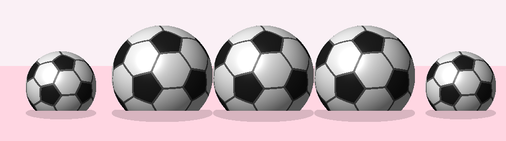
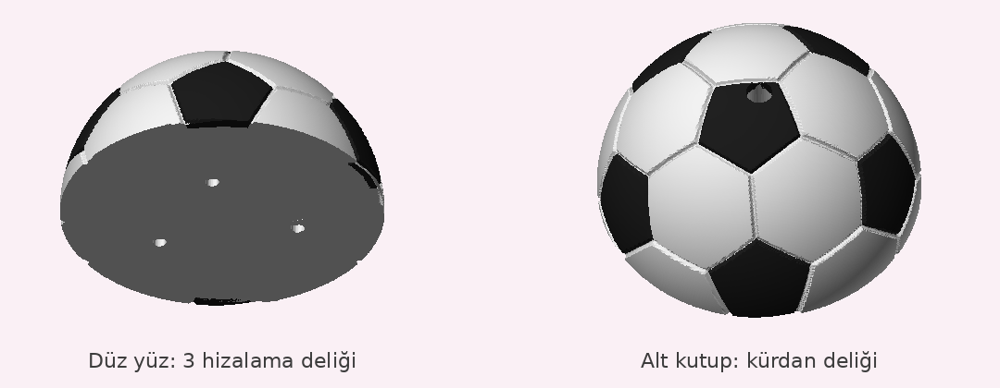

# ⚽ Pasta Süsü Futbol Topu



Siyah-beyaz klasik futbol topu: 12 siyah beşgen, 20 beyaz altıgen, aralarında dikiş oyukları.
Alt kısmı düz kesik; destek gerekmeden basılır ve pastada devrilmez. Altta çubuk ya da kürdan için 4,2 mm delik var.

| Boy | Çap | Yükseklik | Adet |
|---|---|---|---|
| Büyük | 50 mm | 42,5 mm | 3 |
| Orta | 35 mm | 30 mm | 2 |

## Dosyalar (`stl/`)

| Dosya | Ne zaman |
|---|---|
| `top-50mm-iki-renk.3mf`, `top-35mm-iki-renk.3mf` | **Çok renkli yazıcı** (AMS/MMU): siyah ve beyaz parçalar tek nesne olarak gelir, parçalara renk ata |
| `top-XXmm-beyaz.stl` + `top-XXmm-siyah.stl` | Aynısı, ayrı STL olarak (ikisini birlikte "tek nesne, çok parça" diye içe aktar) |
| `top-XXmm-tek-renk.stl` | **Tek renkli yazıcı**: beyaz bas, beşgenleri siyah akrilik boya/kalemle boya. Oyuklar boyama sınırı olur |

## Snapmaker U1 ile baskı

1. **Snapmaker Orca**'da `stl/tabla-3-buyuk-2-orta-iki-renk.3mf` dosyasını aç. "Tek nesne, çok parça olarak yüklensin mi?" diye sorarsa **Evet** de.
2. Kafa 1'e **beyaz**, kafa 2'ye **siyah** PLA tak; Orca'da filamentleri eşleştir.
3. Sol paneldeki nesne listesinde `beyaz` parçaya 1. filamenti, `siyah` parçaya 2. filamenti ata.
4. Doluluk %5–10, destek kapalı, katman 0,16 mm → Dilimle → Yazdır.

## Önerilen dilimleyici ayarları

- Katman: 0,16 mm (yuvarlaklık için), duvar: 3
- Doluluk: **%5–10** (içinin dolu olmasına gerek yok)
- Destek: **kapalı**; alt düz yüzey tablaya oturur
- Tek renkli baskıda: dilimleyicide 3 büyük + 2 orta kopya ekle, hepsini tek seferde bas

## Tam yuvarlak versiyon (iki yarım küre)



`stl/yarim/` klasöründe. Her top iki yarım olarak basılıp yapıştırılır; iki yarım da düz yüzü tablada, **desteksiz** basılır.

- **Snapmaker U1:** `tabla-yarim-3-buyuk-2-orta-iki-renk.3mf` → 10 yarım tek tablada, `beyaz`/`siyah` parçalarına filament ata.
- **Tek renk:** `yarim-XXmm-ust-tek-renk.stl` + `yarim-XXmm-alt-tek-renk.stl`.

**Birleştirme:**
1. Her yarımın düz yüzünde 3 delik var. 1,75 mm filamentten **~5,5 mm**'lik 3 parça kes, bir yarımın deliklerine tak.
2. Düz yüzlere ince bir kat hızlı yapıştırıcı (japon yapıştırıcısı) sür, diğer yarımı pimlere oturt. Deliklerden biri farklı mesafede olduğu için yarımlar yalnızca doğru açıda birleşir, desen tam oturur.
3. Ek yeri desenin içinden geçer; gerekirse ince zımparayla düzelt.

Alt yarımın kutbunda kürdan/çubuk deliği var; top pastaya bununla sabitlenir.

## Gıda güvenliği

PLA gıdaya temas için onaylı değildir. Topları doğrudan kremaya değil, şeker hamuru üstüne ya da altına
streç film/kürdan kullanarak koyun.

## Yeniden üretmek

```bash
pip install trimesh manifold3d networkx lxml scipy
python3 futbol_topu.py   # stl/ klasörünü üretir
python3 onizleme.py      # onizleme.png
python3 yarim_top.py     # stl/yarim/ (iki yarım küre)
```
