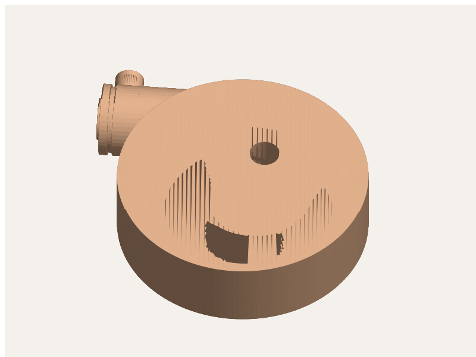
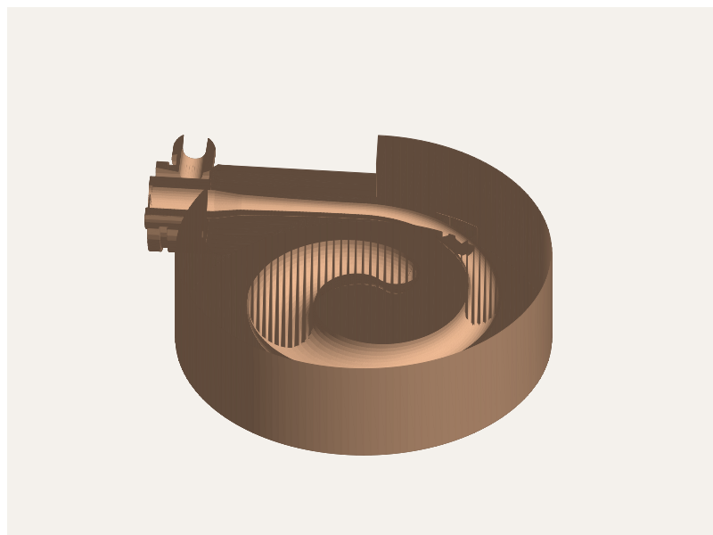

# Sesin Şekli 🗣️ → 🧊

**Bir insanın ses kaydından, üflendiğinde o kişinin sesli harf tınısını veren 3D baskı bir ses yolu üretir.**

Basılı ses yolu modelleri bugüne kadar hep **MRI taramasından** yapıldı (ör. Dresden Vocal Tract Dataset, 3000 yıllık Mısırlı rahibin sesi).
Bu prototip MRI yerine **sadece telefon kaydı** kullanıyor: sesten formantları çıkarıyor, o formantları veren bir tüp şeklini ters çözümle buluyor ve doğrudan basılabilir STL üretiyor.

```
kayıt.wav ──► formantlar (LPC) ──► ters çözüm ──► tüp profili ──► STL + önizleme sesi
                                                                   │
           baskının kaydı ◄── üfle / hoparlörle çal ◄── 3D yazıcı ◄┘
                 │
                 └──► ölç: hedefle karşılaştır, gerekirse uzunluğu düzelt
```

## Kurulum

```bash
cd sesin-sekli
pip install -r requirements.txt     # numpy, scipy, manifold3d (kolye için)
```

## Kullanım

**1. Ses kaydet.** Telefonla sessiz bir odada, 2-3 saniye boyunca tek ve sabit bir sesli harf söyle ("aaaaa"). Kaydı `.wav` olarak kaydet (mono, 16 kHz veya üstü). Kayıt uygulaması m4a veriyorsa:
`ffmpeg -i kayit.m4a kayit.wav`

**2. Tasarla**

```bash
python3 -m sesin_sekli tasarla --wav kayit.wav -o benim_a/
# kayıt yoksa hazır ortalama ünlülerle dene:
python3 -m sesin_sekli tasarla --unlu a -o deneme_a/      # a e ı i o ö u ü
python3 -m sesin_sekli tasarla --formant 730,1090,2440 -o deneme/
```

Çıktı klasörü:

| Dosya | Ne işe yarar |
|---|---|
| `ses_yolu.stl` | Basılacak model |
| `onizleme.wav` | **Basmadan önce dinle**: simüle edilen ses |
| `profil.svg` | Kanalın yandan kesiti |
| `profil.csv` | z (mm) ve iç yarıçap (mm) |
| `rapor.json` | Hedef ve elde edilen formantlar, ölçüler, sarkma açısı |

**3. Bas.** Hazır örnekler: [`ornek/a/ses_yolu.stl`](ornek/a/ses_yolu.stl) ve [`ornek/i/ses_yolu.stl`](ornek/i/ses_yolu.stl)

- **Yön:** Dik bas, dar boyunlu (glottis) uç tablada olsun. Destek gerekmez, rapor 45° üstü sarkmada uyarır.
- **Malzeme:** PETG veya PLA. İç yüzey ne kadar pürüzsüzse o kadar iyi; reçine (SLA) en iyisi.
- **Ayarlar:** 0.2 mm katman, **en az 4 duvar (perimeter)**, %15 dolgu. Duvarlar ince olursa tüp titreşir ve ses kaybolur.
- **Boyut:** /a/ yaklaşık 150 mm, /u/ 210 mm'ye kadar çıkabilir. A1 mini gibi küçük tablalarda yükseklik sınırına dikkat et.

**4. Ses kaynağı.** Gerçek ses tellerinin yerine bir şey titreşmeli:

- **En kolayı:** `python3 -m sesin_sekli vizilti -o vizilti.wav` ile sinyali üret, telefonun hoparlöründen çal ve hoparlörü boyun ucuna dayayıp sızdırmaz yap (hamur veya bant). Ağız ucundan bir sesli harf duyulmalı. Tüpsüz çaldığında sadece vızıltı duyarsın, aradaki fark tüpün işi.
- **Üflemeli:** Boyuna (iç çap 9 mm) bir kazak düdüğü veya armonika dili tak, ya da gergin balon zarlı küçük bir "yapay gırtlak" yap. Dresden'deki çalışmalar da dil (reed) kaynağı kullanıyor.

**5. Ölç ve düzelt**

```bash
python3 -m sesin_sekli olc --wav baski_kaydi.wav --tasarim benim_a/
```

Basılan tüpün sesini kaydet. Araç ölçülen formantları hedefle karşılaştırır; ortak sapma %2'den büyükse uzunluğu düzeltilmiş `ses_yolu_duzeltilmis.stl` üretir.

## Kolye modu 📿

```bash
python3 -m sesin_sekli tasarla --wav kayit.wav --kolye -o kolye/
```

`kolye.stl`: Ses yolu düz bir madalyonun içine spiral olarak sarılı, ses kaynağı da (gırtlak) madalyonun üzerinde. Hazır örnek: [`ornek/kolye_a/kolye.stl`](ornek/kolye_a/kolye.stl) (/a/, Ø65 × 19 mm).

 

```
   üfleme borusu ─┐
             ┌────┴────┐
 balon zarı ►│ gırtlak │═══ boğaz ═══╗  spiral kanal
             └─────────┘             ║  (içe doğru)
                                     ╚═══► merkezde ön yüzden ağız deliği → "aaaa"
```

**Nasıl ses çıkıyor:** Kanalın girişi bir "dudak" kenarıyla bitiyor. Etrafındaki haznenin ağzına balon zarı geriliyor ve zar bu kenara hafifçe yaslanıyor. Yandaki borudan üfleyince hava zarı kenardan kaldırıyor, kanala kaçıyor, basınç düşünce zar geri çarpıyor. Bu, saniyede yüzlerce kez tekrarlanan bir vızıltı demek: dudakla trompet çalmak ya da vuvuzela ile aynı ilke. Vızıltı spiral kanaldan geçerken sesli harfe dönüşüyor.

**Toplama:**
1. Madalyonu yatık bas (ön yüz yukarıda). Kanal kesiti damla biçimli, bu sayede destek gerekmez. 0.12–0.16 mm katman kullan, zarın yaslandığı kenar pürüzsüz olsun.
2. Bir balonun boyun kısmını kes, kalan zarı gırtlak haznesinin ağzına **hafif gerilimle** geç. Zar ortadaki kanal ağzına değmeli.
3. Zarı hazne dışındaki oluğa ip veya ince lastikle bağla.
4. Yan borudan yavaşça üfle. Ses çıkmazsa zarın gerginliğini değiştir: daha gergin zar daha ince ses, daha gevşek zar daha kalın ses verir. Zar kenara hiç değmiyorsa ses çıkmaz.
5. İpi sağ üstteki halkadan geçir.

**Ölçüler:** Kanal çapı 3,2–12,8 mm arasında sınırlı; ünlüler için gereken dar/geniş oranı korunuyor. Madalyonun kalınlığını en geniş kanal kesiti belirliyor (~19 mm). Spiral, düz kısım ve ağız deliğinin toplam uzunluğu akustik modeldeki uzunluğa eşit; bunu `tests/` doğruluyor.

**Belirsizlikler (henüz denenmedi):**
- Kıvrımların sese etkisi modelde yok. Ölçüp düzeltmek için `olc` komutunu kullan; kolye için de `kolye_duzeltilmis.stl` üretiyor.
- Zarlı kaynak kanala güçlü bağlanırsa, vızıltı sesli harf gibi değil trompet gibi kanalın kendi tonunda çalabilir. Böyle olursa daha kalın ve gevşek bir zar dene. Bir yedek plan olarak telefon hoparlörüyle `vizilti.wav` çalmak her zaman çalışır.

## Nasıl çalışıyor

- **`akustik.py`:** Ses yolu, birbirine bağlı 36 silindir olarak modelleniyor. Her silindir bir 2×2 iletim matrisi; modele duvar kayıpları ve dudak radyasyon empedansı da dahil. Sonuç olarak U_dudak/U_glottis transfer fonksiyonu çıkıyor ve bunun tepeleri formantlar.
- **`formant.py`:** Kayıt 10 kHz'e örnekleniyor, kayan pencerelerde 12. derece LPC uygulanıyor ve medyan formantlar alınıyor.
- **`ters_cozum.py`:** Log-alan fonksiyonu 6 kosinüs bileşeniyle ve uzunlukla ifade ediliyor (13–21 cm). Differential evolution ile göreli formant hatası en aza indiriliyor. Çap 6,7–34 mm arasında sınırlı tutuluyor ki model basılabilir olsun.
- **`geometri.py`:** Basamaklı profil yumuşatılıyor, su geçirmez STL üretiliyor (dış yüzey düz silindir) ve sarkma kontrol ediliyor.
- **`kolye.py`:** Arşimet spirali, damla kesitli süpürme (dönme-minimize çerçeveler), gırtlak haznesi, üfleme borusu ve ip halkası. Parçalar manifold3d ile birleştirilip boşluklar oyuluyor; çıktı su geçirmez bir katı.
- **`sentez.py`:** Rosenberg glottal darbeleri, hafif vibrato ile tüpten geçirilerek önizleme sesi üretiliyor.

**Doğrulama (`tests/`):** Düzgün tüp çeyrek-dalga teorisiyle uyuşuyor. /a/, /i/ ve /u/ için ters çözüm hatası %1'in altında. Sentetik kayıttan formant çıkarma hatası %5'in altında. STL su geçirmez ve baskı profili hedefi %2 içinde tutuyor.

```bash
python3 tests/test_sesin_sekli.py     # ~1,5 dk
```

## Dürüst sınırlar

- **Konuşmaz.** Tek bir sesli harfin tınısını verir. Kelime söyletmek, zamanla şekil değiştiren bir mekanizma gerektirir.
- **Kimlik kısmi.** Formantlar kişiye özgüdür, ama ses tellerinin karakteri (perde, nefeslilik) kaynaktan gelir, tüpten değil.
- **Tek çözümlü değil.** Aynı sesi veren birçok şekil var ve bu, anatomik bir kopya değil. Hedef, aynı tınıyı veren basılabilir bir şekil.
- **Model basit.** Modelde burun boşluğu, duvar titreşimi ve 3D dalga etkileri yok. Gerçek baskıda birkaç yüzde sapma beklenir; `olc` komutu bunun için var.
- **Yüksek perdeli sesler** (kadın ve çocuk sesi) LPC'yi zorlar, formant çıkarma hatası artabilir. Mümkün olduğunca alçak perdeden söylemek yardımcı olur.

## Sonraki adımlar

1. **Gerçek baskı denemesi.** /a/ ve /i/ örneklerini basıp `olc` ile ölçmek ve model katsayılarını (`KAYIP`, uç düzeltmesi) gerçek veriye göre kalibre etmek.
2. **Daha küçük kolye.** Spirali iki kata bölerek madalyonu ~45 mm'ye indirmek.
3. **Çoklu ünlü.** Aynı kişinin a, i ve u seslerinden oluşan, döndürülerek seçilebilen tek bir nesne.
4. **Web arayüzü.** Tarayıcıda kaydet, STL'i indir.
